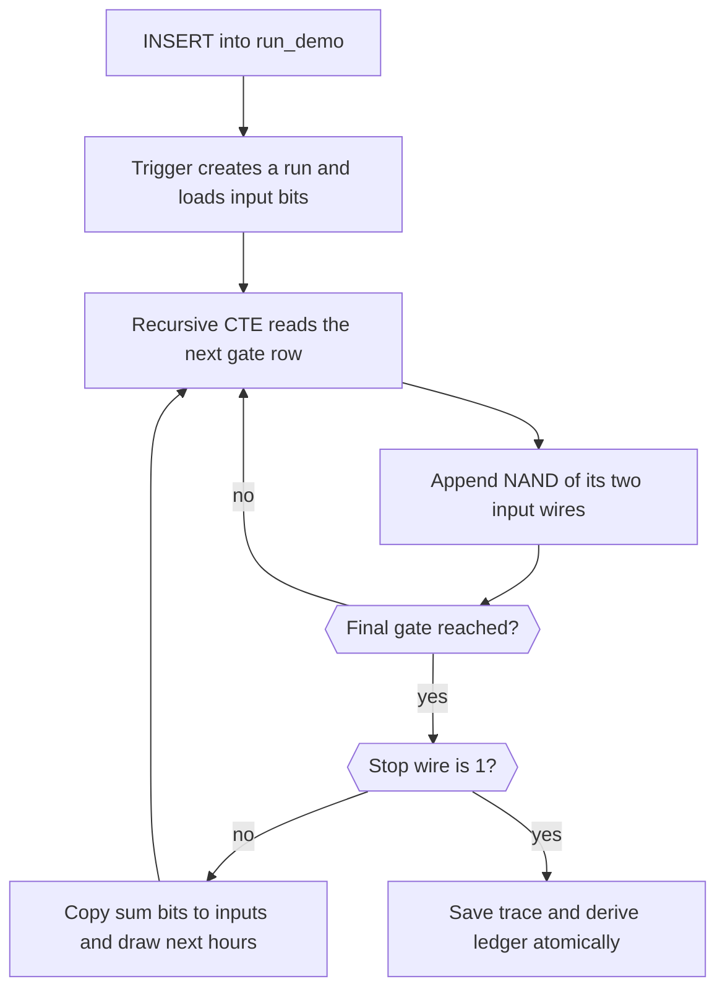

# SQLite: a computer made of database rows

**Teaches you:** that database rows can describe a NAND circuit, and a recursive query can clock it.

> **DEMO ONLY.** Fictional timecards in a scratch database. No real time-reporting connection.

SQLite has been asked to store timecards in most of these entries. This time it has to be the computer too. Its tables contain a six-bit ripple-carry adder and a greater-than-40 comparator, built from 65 NAND gates. SQL may generate hours and decode the finished bits for display. It may never add the running total or compare that total with 40. Those answers must travel through the gates.

## Run it

You need stock SQLite 3.38 or newer with JSON support, a POSIX shell, `mkdir` and `cat`. The launcher checks SQLite's version and JSON support before setup. No extension, host-language callback or GUI is involved.

```sh
cd src/sqlite-weird
sh run.sh
SEED=12345 RUN_DATE=2021-01-01 sh run.sh
```

The database is `$XDG_DATA_HOME/SQLiteWeird/demo-timecards.db`, falling back to `${TMPDIR:-/tmp}/SQLiteWeird/demo-timecards.db`. Set `SQLITE3` to an alternate SQLite executable. `SEED` must be an integer from 1 through 2147483646; `RUN_DATE` must be a valid `YYYY-MM-DD` date. Defaults are generated inside SQL: a random seed and today's UTC date. A Park–Miller generator advances once per card, producing `10 + state % 10` hours. Categories rotate Meetings, Coding, Debugging, Learning, then Meetings again.

The first launch installs [schema.sql](schema.sql); later launches reuse the saved procedure. The report shows category, hours, total and ISO week, then the input bits, outgoing carries, sum bits and stop wire. Every report is labeled **DEMO ONLY**. Bits print least significant first: `100000` means one, not thirty-two.

For example, seed 12345 produces hours 15, 14 and 16: totals 15, 29 and 45. January 1, 2021 belongs to `2020-W53`. The third card remains in the ledger because its stop wire is the first one to become 1.

You can use a fresh SQLite connection directly, without the launcher:

```sh
sqlite3 /path/to/demo-timecards.db 'INSERT INTO run_demo DEFAULT VALUES;'
sqlite3 /path/to/demo-timecards.db "INSERT INTO run_demo(seed,run_date) VALUES(12345,'2021-01-01');"
```

To install manually in an empty database, run `sqlite3 -bail demo.db < schema.sql` first. Run `sqlite3 -header -column demo.db < report.sql` to see the latest saved run.

## Program Flow



**What this shows:** one recursive CTE is the clock, and one step evaluates one NAND gate. At the card boundary, the sum wires become the next input wires. A five-card guard aborts a broken circuit that never halts.

**Why this mechanism matters:** the database's ordinary rows specify the machine's wiring, while the recursive query interprets those rows. Changing a connection changes the answer; changing the stop gate changes when the machine stops. The trace makes both effects inspectable.

## How the stunt works

**Wires are array positions.** Positions 0 and 1 are constants; 2–7 hold the previous total; 8–13 hold the new hours. Gate output wires occupy 14–78. Every gate references two smaller wire numbers, so the netlist is acyclic and needs no settling-time algorithm. The `wires` view gives inputs and outputs names. The `gates` table stores each output wire's name and its two input connections.

**NAND is the only gate operation.** The evaluator appends `NOT (a AND b)` to the JSON array. Inverting a bit is NAND with the same input twice. An AND is a NAND followed by inversion; an OR is a NAND of inverted inputs. To get XOR, compute `t=NAND(a,b)`, `u=NAND(a,t)`, `v=NAND(b,t)` and `x=NAND(u,v)`. That is four gates.

**A full adder takes nine NANDs.** The first four produce `x=a XOR b`. Next compute `p=NAND(x,carry_in)`, `q=NAND(x,p)`, `r=NAND(carry_in,p)` and `sum=NAND(q,r)`. The ninth gate, `carry_out=NAND(t,p)`, is the carry. Six copies connect each carry to the next bit; the initial carry is constant zero. Output wires `21,30,39,48,57,66` are the sum, and `22,31,40,49,58,67` are the outgoing carries.

**The comparator is also wiring.** Forty is binary `101000` in conventional most-significant-first notation. A six-bit number exceeds it precisely when `S5 AND (S4 OR (S3 AND (S2 OR S1 OR S0)))` is true. Eleven more NAND gates implement that expression; wire 78 is the stop signal. In particular, 40 continues and 41 stops. Six bits cover every reachable answer: previous totals are at most 40, hours at most 19, and the largest final total is 59.

**A stored query supplies the clock.** The `clock` view contains one recursive CTE with a gate transition and a card transition. Gate numbers are array positions, so each gate extends the array by exactly one binary value. At the boundary, the query copies the six sum bits directly into the next card's accumulator slots. It never decodes that accumulator to generate an answer. Generator arithmetic, gate indexing, category selection, ISO-week dates and display conversion use ordinary SQL arithmetic.

**An insert is the procedure call.** SQLite documents [INSTEAD OF triggers on views](https://sqlite.org/lang_createtrigger.html#instead_of_triggers) and [recursive CTE evaluation](https://sqlite.org/lang_with.html#recursive_common_table_expressions). The persistent `run_demo` view accepts the optional seed and date. Its trigger creates a run, inserts the clock's rows into `trace`, derives `ledger` from final-gate rows, and marks the run complete. The CTE lives in a view to avoid the restrictions on statements directly inside trigger bodies. This uses documented SQLite behavior, including JSON functions; it does not depend on recursive triggers.

One insert is atomic, including its trigger's effects. Failure rolls back the new run, trace and ledger. The launcher also wraps invocation and reporting in `BEGIN IMMEDIATE` so another writer cannot replace its latest-run report. A partial unique index permits only one running run. Completed runs retain separate IDs and traces. The ISO-week query finds the week's Thursday, then uses its year and day of year, without newer `%G` or `%V` formatting specifiers.

**Inspect the computer.** Open the database in `sqlite3`. These queries show named connections and every gate transition for the first addition of the latest run:

```sql
SELECT 'DEMO ONLY' AS marker,g.wire,g.name,a.name AS input_a,b.name AS input_b
FROM gates g JOIN wires a ON a.wire=g.a JOIN wires b ON b.wire=g.b
ORDER BY g.wire;

SELECT 'DEMO ONLY' AS marker,t.card,t.gate,g.name,
       json_extract(t.signals,'$['||g.a||']') AS a,
       json_extract(t.signals,'$['||g.b||']') AS b,
       json_extract(t.signals,'$['||g.wire||']') AS nand_output
FROM trace t JOIN gates g ON g.wire=t.gate
WHERE t.run_id=(SELECT max(id) FROM runs) AND t.card=1
ORDER BY t.gate;

SELECT 'DEMO ONLY' AS marker,run_id,card,signals
FROM trace WHERE gate=13 ORDER BY run_id,card;
```

The last query shows card input arrays before any gate runs. [report.sql](report.sql) contains the full SQL used for the human-readable circuit explanation.

## What check.sh enforces

```sh
bash src/sqlite-weird/check.sh
bash sandbox/dockerfile-lint.sh src/sqlite-weird/Dockerfile
```

Checks need Node.js 24+ with `node:sqlite`, plus the SQLite CLI and Bash. Node is only an independent test oracle; the runtime image needs only SQLite and shell utilities.

[check.mjs](check.mjs) exercises the exact gate-evaluation SQL extracted from the stored clock view. It exhaustively checks all 410 combinations of previous totals 0–40 and hours 10–19, and all 64 comparator inputs, including 39, 40 and 41. It checks ordered connections, binary signals, array lengths, output reachability and saved traces. Source checks plus the readable SQL enforce the computation boundary; the source checks are a guard against accidental changes, not a general SQL proof system.

The checks also verify deterministic and random runs, a five-card run retaining total 40, category rotation, Park–Miller advancement, ISO-week year boundaries, totals and crossing-card retention. They compare reports with persisted rows, reopen a file in a fresh connection, reject invalid inputs, and test repeated-run separation. Isolated databases corrupt an adder connection and force the stop wire high; the checks detect changed behavior. A forced-low stop wire and an injected trace-write failure prove rollback. The shell checks run the launcher twice, compare its output and invoke the procedure from a fresh stock SQLite CLI connection without reinstalling anything.

## Gotchas worth knowing

This is a small combinational-circuit simulator with a SQL clock and persistence, not a general CPU or an unbounded computer. It has no instruction set, RAM addressing or hardware timing. Widening the adder requires changing the comparator, input loading and report decoding together.

Successful runs have three to five cards. The five-card cap is a failure guard, not the normal stop rule: reaching it without a high stop wire raises an error. Traces include an initial input row plus 65 gate rows per card and are deliberately retained. There is no automatic pruning or schema migration. Remove a scratch database only when you no longer need its traces.

`run.sh` expects its scratch database to belong to this entry. Sequential first-time setup is sufficient for this demonstration; simultaneous first-time installers may contend. Database constraints reject malformed seeds and dates. Only demo data is supported. Keep all of it separate from real time reporting.

## Run it in a container

After the repository's [Docker setup](../../SANDBOX-SETUP.md#docker), build the `cc-rt-sqlite` base with `sandbox/container/build-bases.sh`, then run:

```sh
sandbox/container/run-image.sh src/sqlite-weird
```

The [Dockerfile](Dockerfile) copies only the SQL sources and launcher onto `cc-rt-sqlite:local`. The shared harness runs as an unprivileged user with no network and a writable scratch directory, prints the report, and inspects the saved database. No generated database is committed. Textbook expansion and publication rebuilding are separate follow-up work.
